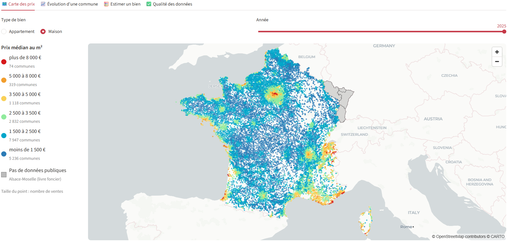
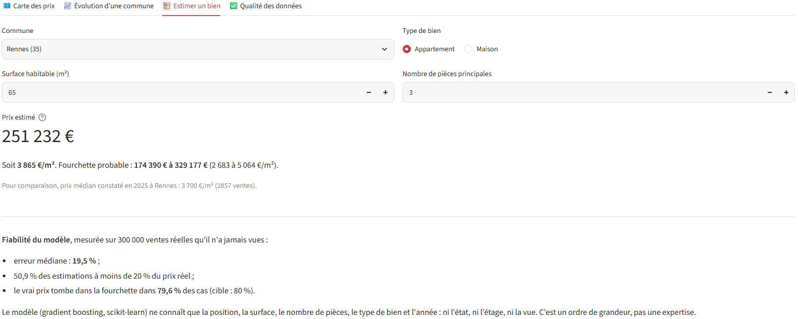

# Prix de l'immobilier en France 2021-2025


> 🇬🇧 *An interactive Streamlit dashboard of French property prices built from 7 million raw sales records (DVF open data): a cleaning pipeline that documents every rule, a map of median prices per square metre for 24,000 municipalities, price trends, and a machine-learning estimator (scikit-learn) whose accuracy is measured honestly on unseen sales.*



## Le problème

L'État publie chaque vente immobilière de France sur [data.gouv.fr](https://www.data.gouv.fr/datasets/demandes-de-valeurs-foncieres-geolocalisees) : ce sont les Demandes de valeurs foncières (DVF), soit 7,3 millions de mutations entre 2021 et 2025. Calculer naïvement une moyenne sur ces données donne pourtant des résultats faux :

- **Une vente occupe plusieurs lignes.** On compte une ligne par lot, par parcelle et par nature de terrain, et le prix total est répété sur chacune.
- **Un immeuble entier peut être vendu en un seul prix.** Le diviser par la surface d'un seul appartement n'a aucun sens.
- **Des ventes ne reflètent pas le marché :** ventes symboliques à 1 €, échanges, adjudications, logements neufs vendus sur plan (VEFA).

## La solution

`preparation.py` nettoie les données en appliquant des règles explicites, et **compte les ventes écartées à chaque étape**. Le résultat ressemble à ceci pour 2025 :

| Étape | Ventes restantes | Part |
|---|---|---|
| Mutations publiées | 1 314 051 | 100 % |
| Ventes classiques (hors VEFA, échanges, adjudications…) | 1 245 125 | 94,8 % |
| Un seul prix par mutation | 1 241 403 | 94,5 % |
| Un seul logement, sans local commercial (dépendances admises) | 812 168 | 61,8 % |
| Surface ≥ 9 m² et au moins une pièce | 811 022 | 61,7 % |
| Coordonnées GPS connues | 807 508 | 61,5 % |
| Prix au m² entre 300 et 25 000 € | **798 292** | **60,8 %** |

Le script produit ensuite :
- le **prix médian au m²** par commune, par type de bien et par année. Il n'est publié qu'au-delà de 5 ventes, car en dessous une médiane ne veut rien dire ;
- un **modèle d'estimation** (gradient boosting, scikit-learn) entraîné sur 1,5 million de ventes. Il donne un prix et une fourchette (10e-90e centile).

L'application Streamlit (`app.py`) propose quatre onglets : la carte des prix, l'évolution d'une commune, l'estimation d'un bien et le rapport de nettoyage.

## Un modèle évalué honnêtement

Le modèle est mesuré sur 300 000 ventes réelles qu'il n'a jamais vues :

| Mesure | Résultat |
|---|---|
| Erreur médiane | 19,5 % |
| Estimations à moins de 20 % du prix réel | 50,9 % |
| Vrai prix compris dans la fourchette | 79,6 % (cible : 80 %) |



Le modèle ne connaît que la position, la surface, le nombre de pièces, le type de bien et l'année. Il ignore l'état du logement, l'étage, la vue ou le DPE. Il donne donc un ordre de grandeur, et l'application le dit clairement. Ce qui compte surtout, c'est que **la fourchette annoncée est fiable** : un test a révélé qu'une première version, pas assez régularisée, ne contenait le vrai prix que dans 59 % des cas, et je l'ai corrigée.

## Lancer le projet

```bash
pip install -r requirements.txt
streamlit run app.py       # l'application, avec les données agrégées fournies dans data/
pytest                     # les tests
python preparation.py      # optionnel : tout recalculer depuis DVF (environ 540 Mo à télécharger, 10 min)
```

## Tests

Les tests (`tests/test_preparation.py`) reproduisent les pièges de DVF sur un mini-fichier et vérifient que :
- une maison répétée sur plusieurs lignes ne compte que pour une vente ;
- les ventes de plusieurs logements, les VEFA, les ventes à 1 €, les ventes avec un local commercial et les surfaces de 5 m² sont écartées ;
- le rapport ne fait jamais apparaître plus de ventes à une étape qu'à la précédente ;
- une médiane n'est publiée qu'au-delà de 5 ventes ;
- le modèle retrouve une relation connue sur des données synthétiques, et sa fourchette contient bien environ 80 % des cas.

## Limites

- **Bas-Rhin, Haut-Rhin et Moselle (Strasbourg, Mulhouse, Metz…) :** les ventes y sont inscrites au livre foncier, un registre de droit local tenu par le ministère de la Justice. La DGFiP n'en dispose pas, et ces données ne sont pas ouvertes : elles ne se consultent que sur demande payante. Il n'existe donc aucune source libre pour ces départements. La carte les affiche en gris, avec une mention explicite, plutôt que de laisser un trou inexpliqué. Mayotte est également absente de DVF.
- Paris, Lyon et Marseille sont détaillés par arrondissement.
- Les données 2025 sont celles publiées en mai 2026. Le second semestre peut encore être complété.

## Sources

- [Demandes de valeurs foncières géolocalisées — DGFiP / Etalab, data.gouv.fr](https://www.data.gouv.fr/datasets/demandes-de-valeurs-foncieres-geolocalisees)
- [Pourquoi l'Alsace-Moselle est absente de DVF — FAQ de l'explorateur DVF, data.gouv.fr](https://explore.data.gouv.fr/fr/immobilier?onglet=faq)
- Contours des départements : [france-geojson](https://github.com/gregoiredavid/france-geojson) (d'après l'IGN, version simplifiée)

---
Hugues Barbier, data scientist Python freelance : automatisation Excel, ETL et fiabilisation de données.
